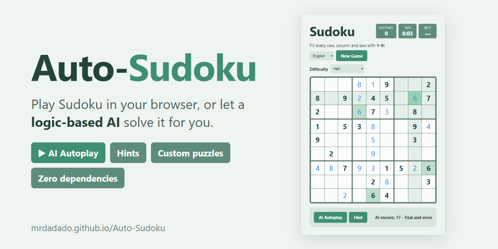
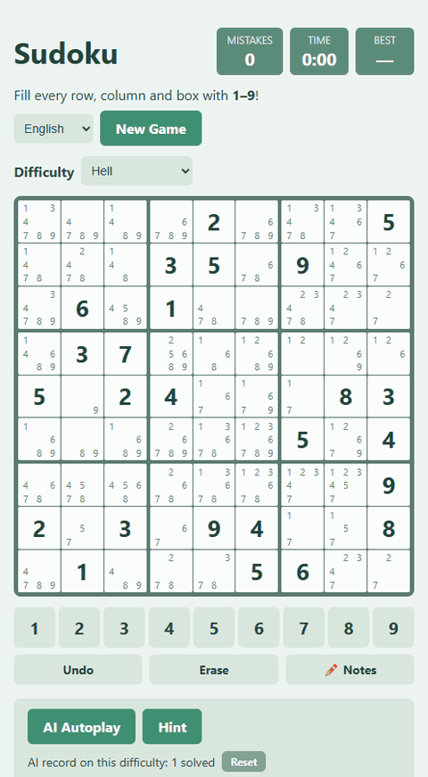
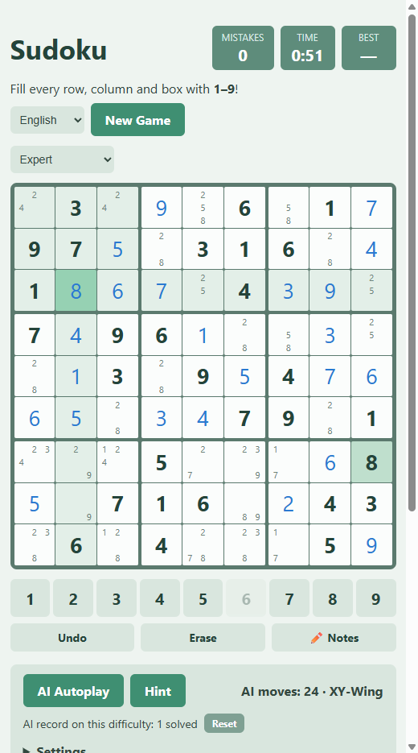

<div align="center">



# Auto-Sudoku

**Sudoku in the browser with a logic-based AI that solves it for you, one technique at a time.**

[](https://mrdadado.github.io/Auto-Sudoku/)

**Play online: https://mrdadado.github.io/Auto-Sudoku/**

[](LICENSE)


[](https://github.com/MrDaDaDo/Auto-Sudoku/stargazers)



<sub>The AI solving a Hell puzzle (25 givens) one cell at a time, with candidates shown and the technique of each move</sub>

</div>

A dependency-free browser version of **Sudoku** with a built-in **AI solver** that can play the puzzle for you, suggest your next move, or solve any puzzle you type in. Just open the page and hit **AI Autoplay**.

> If you find this project fun or useful, please consider giving it a ⭐ — it really helps!

## Features

- **Six difficulty levels**, from Beginner to Hell, generated on the fly; every puzzle has exactly one solution, and everything up to Expert can be solved by logic alone
- **Mouse, keyboard and touch controls**: click a cell and type **1–9** or use the number pad; arrow keys to move, **Backspace** to erase, **N** for notes, **Ctrl+Z** to undo, **F2** for a new game
- **Notes**: pencil in candidates by hand, or turn on **Show candidates** to fill them in automatically
- **AI Autoplay**: lets the AI fill the grid one cell at a time and shows which technique each move needed
- **Hint**: highlights the next cell the AI would fill and names the technique
- **Custom puzzle**: type or paste any Sudoku (81 digits, `0` or `.` for empty cells) and let the AI solve it
- **Highlight mistakes**, mistake counter, timer and **best times** per difficulty
- **Auto restart + stats**: let the AI solve puzzle after puzzle and count how many it has solved
- **Light and dark themes**: follows your system setting, with a toggle that is remembered across all Auto Games
- **Multilingual UI**: English, 繁體中文, 简体中文, 日本語, 한국어 (auto-detected from the browser, selection remembered)
- Settings, best times and AI stats saved in `localStorage`

## Getting Started

No build step or dependencies are required.

1. Clone the repository:
   ```bash
   git clone https://github.com/MrDaDaDo/Auto-Sudoku.git
   ```
2. Open `index.html` in a modern browser.

## How the AI Works

The solver keeps a set of **candidates** (the digits that can still go there) for every empty cell, and solves the way a person does. It tries the techniques below from easiest to hardest and takes the first one that makes progress:

| Level | Technique | Idea |
| --- | --- | --- |
| 1 | Naked single | A cell has only one candidate left |
| 1 | Hidden single | A digit has only one possible cell in a row, column or box |
| 2 | Locked candidates | A digit's cells in one unit all lie inside another unit, so it can be removed from the rest of that unit |
| 2 | Naked / hidden pair | Two cells share two candidates, or two digits share two cells |
| 3 | Naked / hidden triple, naked quad | The same idea with three or four cells |
| 3 | X-Wing, Swordfish | A digit is confined to the same 2 (or 3) columns in 2 (or 3) rows, or the other way round |
| 3 | XY-Wing | A pivot cell `{x,y}` sees two cells `{x,z}` and `{y,z}`; any cell seeing both cannot be `z` |

Singles place a digit; the other techniques only remove candidates, and the solver keeps applying them until a single appears. Each AI move fills exactly one cell and is labelled with the hardest technique it needed.



If logic runs out (which happens on **Hell** puzzles and can happen on a **custom puzzle**), the solver falls back to a **backtracking search** that always branches on the cell with the fewest candidates, and the move is labelled *Trial and error*. The same search checks that a custom puzzle has exactly one solution before the game starts.

### Puzzle generation

1. Fill an empty grid with a randomized backtracking search to get a complete solution.
2. Remove digits in random order, two at a time (point-symmetric), keeping a removal only if the puzzle can still be solved by the techniques allowed for the chosen difficulty. A puzzle that logic can finish has exactly one solution.
3. Grade the result by the hardest technique it needs, and retry until it matches the difficulty.

**Hell** is generated differently: digits are removed one at a time with no symmetry, keeping a removal as long as the solution stays unique, and the puzzle is accepted only if the techniques above get stuck with at least 40 cells still empty.

Measured over 300 generated puzzles per difficulty:

| Difficulty | Techniques needed | Average givens | Average time to generate |
| --- | --- | --- | --- |
| Beginner | Level 1 | 45 | 1 ms |
| Easy | Level 1 | 37 | 2 ms |
| Medium | Level 1 | 28 | 5 ms |
| Hard | Level 2 | 27 | 55 ms |
| Expert | Level 3 | 28 | 142 ms |
| Hell | Beyond level 3 (trial and error) | 24 | 17 ms |

All 1,800 puzzles had exactly one solution. The AI solved every Beginner to Expert puzzle without falling back to search, and needed about two trial-and-error moves per Hell puzzle on average.

## Project Structure

```
index.html   Page layout and styles
game.js      Game logic, rendering, input and AI controls
solver.js    Human-technique Sudoku solver, backtracking search and puzzle generator
i18n.js      Translations and language switching
```

## More Auto Games

- [Auto-2048](https://github.com/MrDaDaDo/Auto-2048) – 2048 with a tunable Expectimax AI
- [Auto-Minesweeper](https://github.com/MrDaDaDo/Auto-Minesweeper) – Minesweeper with an exact-probability AI solver

Play them all at https://mrdadado.github.io/

## License

Released into the public domain under [The Unlicense](LICENSE).
